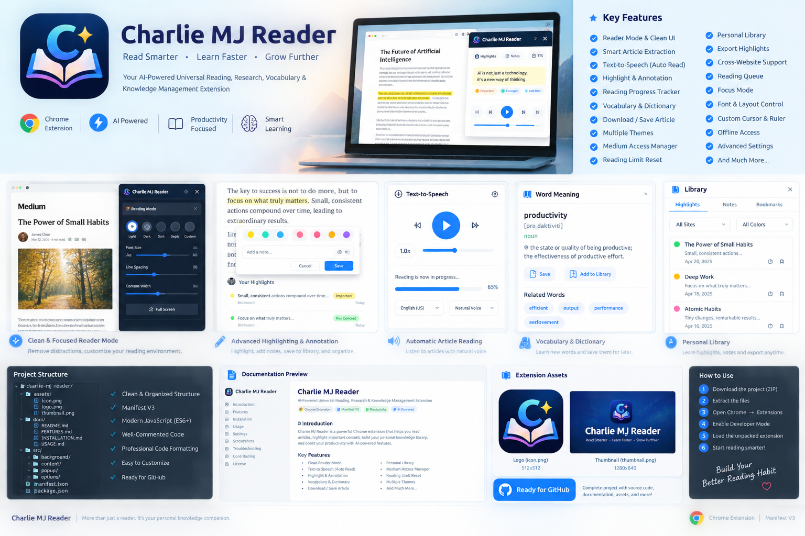
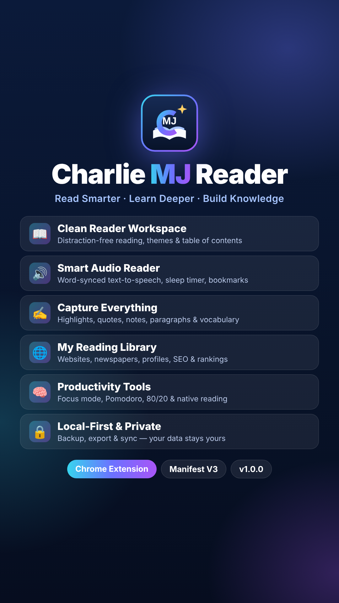

# Charlie MJ Reader

**Read Smarter. Learn Deeper. Build Your Knowledge.**

A local-first Chrome Manifest V3 extension for distraction-free reading, article capture, highlights, notes, vocabulary, synchronized text-to-speech, a website/newspaper library with SEO data, productivity tools and portable backups. Plain JavaScript ES modules, no build step.

<p align="center">
  <a href="/downloads/Charlie-MJ-Reader-v1.0.0-FINAL-WORKING.zip">
    
  </a>
</p>

<p align="center">
  <br>
  
</p>

> **Honesty note.** Everything listed under *Features* exists in the extension. Items under [Not included / limitations](#not-included--limitations) are integration milestones and are **not** claimed as complete.

## Contents

- [Quick start](#quick-start)
- [Features](#features)
- [Settings reference](#settings-reference)
- [Supported websites & toolbar visibility](#supported-websites--toolbar-visibility)
- [Medium / Freedium](#medium--freedium)
- [Data, backup & sync](#data-backup--sync)
- [Permissions and privacy](#permissions-and-privacy)
- [Project layout](#project-layout)
- [Not included / limitations](#not-included--limitations)
- [Developer standards](#developer-standards)
- [Assets & thumbnails](#assets--thumbnails)
- [Documentation](#documentation)
- [License](#license)

## Quick start

1. Download and extract the ZIP.
2. Open `chrome://extensions`.
3. Enable **Developer mode**.
4. Choose **Load unpacked** and select this project folder.
5. Pin Charlie MJ Reader to the Chrome toolbar.
6. Open an article on a supported site (e.g. Medium, dev.to) and use the floating toolbar or the popup.

After updating or reloading the extension, **refresh open web pages** so the content script reconnects.

## Features

### Floating page toolbars
The toolbars are injected into allowed websites only (see [toolbar visibility](#supported-websites--toolbar-visibility)).

| Toolbar | What it does |
|---|---|
| **Main toolbar** | Reader Workspace, Vocabulary, Productivity Reader, Focus, Productivity, night toggle, hide (×). Each module can be switched off globally or per website. |
| **Vocabulary toolbar** | Appears beside selected text: **See Translate**, **Meaning**, **＋ Vocabulary**, **Quote**, **Paragraph**, **Selection**, **Copy**, **Notes** (copy word + translation + source), **Pronunciation**. Optional auto-translate / auto-save. |
| **Media toolbar** | Listen in Productivity Reader, Play / Pause / Stop, progress, speed, bookmark reading position. |
| **Productivity toolbar** | Focus, Day/Night, Pomodoro, 80/20 timer and native-reading controls. |

- **Six toolbar types:** floating, navbar, sidebar, right-sidebar, bottom-navbar, bubble — global default plus per-website override.
- Position (top / bottom / left / right), opacity, and independent colour themes (main, media, vocabulary, productivity).

### Reader Workspace (full-page app)
Sidebar sections: **Dashboard, My Library, See Saved, Bookmarks, History, Highlights, Notes, Quotes, Vocabulary, Collections, Analytics, Exports, Productivity Reader**.

- **Read Yourself** opens a saved article in the Productivity Reader; **Listen** opens it and starts speech.
- Semantic article HTML is captured separately from the UI: headings, paragraphs, lists, quotes, tables, code, links, images and captions are preserved. Content is sanitized (allow-listed tags and attributes; SVG/MathML and inline event handlers are stripped).
- Featured image, author, publication date, description and an automatic **table of contents**.
- Font size, reading width and line height; reading themes: *default-dark, midnight, charcoal, slate, pure-white, soft-white, sepia, warm-paper*.
- **Mouse-follow** line/word focus, current-reading-position focus on the page, and reading-position restore.
- **Right-side capture tools:** save Vocabulary, Quotes, Paragraphs and custom Selections from the reader; saved items keep their source article.
- Reading history, progress and completion tracking, reading analytics (completed articles, tracked audio minutes).

### Smart Audio Reader
Browser Speech Synthesis with synchronized reading:

- Play / resume, pause, stop, previous / next sentence, progress %, word counter.
- Word, sentence or combined highlighting; active-word emphasis; auto-scroll.
- Voice, speed and pitch selection; smart sentence pause.
- **Sleep timer**, bookmark at position, **Add note at position**, repeat word, focus mode.
- Keyboard shortcuts and optional **next-article playback**.
- Starts only on user action (opening an article never auto-plays).
- Word-boundary precision depends on the operating system's voices; a sentence-level fallback is included. See `docs/SMART-AUDIO-READER.md`.

### Capture & saved content
- Save the current page or selection from the popup, toolbar, or right-click **context menu**.
- Highlights (multi-colour field), personal notes, quotes, paragraphs/lines, custom selections, bookmarks and reading-position bookmarks.
- **See Saved** page: per-article cards with counts, and a detail view grouping *Saved Paragraphs & Lines, Saved Words, Saved Quotes, Highlights, Personal Notes, Reading Position Bookmarks, Saved Selections*. Every Article Library card has a **See Saved** button.
- Saved-library **search with suggestions**.

### Vocabulary
- Entries with original text, translation, definition, examples, part of speech, pronunciation, synonyms, notes, tags and source URL.
- Nested **categories** (create, rename, re-parent, delete), copy, edit, delete, **mark mastered**.
- Contextual translation through the public MyMemory endpoint (default Turkish → English; source/target configurable).
- **Revision quiz** with answer check and next-review scheduling (simple scheduler, not a full adaptive SRS).
- Export Vocabulary as **Markdown, CSV or JSON**.

### My Reading Library (websites, newspapers, profiles)
Tabs: **Websites · Newspapers / News · Profile Pages · Favorite · Category · Tags · Saved Articles · Recent · All Saved · General Settings · Compatibility Adapters**.

- **Add current website** (uses your most recent normal web tab) or **add by address**; refresh, import and export; bundled starter list of websites.
- **Newspapers** from anywhere in the world, with country filter.
- **Profile pages** for Medium, DEV, Substack, Hashnode, GitHub and generic `/@name` or `/author/` pages — name, photo, bio, public follower count and recent posts.
- **Automatic categories** (Tech, Health, Science, Business, Lifestyle, Education, Sports, Entertainment, News; mixed publishers become *General*). Manual edits lock the category.
- Logos resolved from schema.org → touch icons → site icons → favicon service → letter fallback.
- **Details** view per site: overview, latest articles (save / SEO audit), SEO & ranking, saved articles, raw JSON.
- **SEO tools:** 14-check on-page score, Tranco domain-popularity rank with trend, Google PageSpeed/Lighthouse SEO + performance, per-article audits with top keywords, robots.txt / sitemap detection, one-click Google `site:` searches.
- Lightweight fetching (12 s timeout, 700 KB cap, limited concurrency).

### Article Library
- Saved Articles are the same records shown in My Reading Library.
- Search, refresh, import / export / download, details, edit, remove.
- **Refresh & Fetch** updates title, subtitle, thumbnail, author, date, canonical URL and readable content from an open source tab.
- Articles carry category, tags, labels, SEO data and rank metadata.

### Focus & productivity
- **Focus mode:** brightness, contrast, page opacity, background dimming, blur, warmth, font scale, hide large images.
- **Day / Night / Auto** mode.
- **Best-effort ad hiding** (DOM/CSS filters; not a full ad blocker).
- **Native reading:** auto-highlights word-by-word on the live page with configurable timer, start delay, word and line colours, bold current word.
- **Pomodoro** and **80/20** timers with configurable durations.

### Notifications
Configurable toast notifications (position: all four corners; duration) with per-event toggles — bookmark, article, vocabulary, quote, paragraph, selection, opened, completed, restored, export, error, plus button-click feedback.

### Exports
- Article: **Markdown, TXT, HTML, JSON** (structure preserved where available).
- Highlights, captures and vocabulary exports.
- Full JSON **backup** and **restore**; complete **database ZIP**.

## Settings reference

Settings center panels: **My Reading Library · Smart Audio Reader · General · Appearance & Themes · Toolbars · Supported Websites · Reading Preferences · Highlight Preferences · Text-to-Speech · Vocabulary · AI Configuration · Notifications · Storage & Backup · Privacy & Permissions · Medium Compatibility · Knowledge Intelligence · Topics & Knowledge · Productivity Centre · Performance & Diagnostics · Database Manager · GitHub Data Sync · Focus**.

Highlights: dashboard/reading themes, accent colour, per-surface toolbar themes, confirm-before-delete, article auto-detection, highlight colour, TTS rate/pitch, translation languages, notification events, Knowledge Intelligence (publisher rules, keyword scoring, minimum confidence, learn from edits), Topics (link articles by ID without duplicating content), Performance & Diagnostics.

## Supported websites & toolbar visibility

Manage domains under **Settings → Supported Websites** (add, enable/disable, edit, remove, import/export JSON, profile validation). Website-specific toolbar type, theme, position and module toggles live in **My Reading Library**.

**Settings → Toolbars → Main Toolbar → Show Toolbar On**

| Option | Toolbar appears on |
|---|---|
| All websites | Every http/https page |
| Supported Websites | Domains in Supported Websites |
| My Reading Library Websites | Domains in your library / saved articles |
| **Supported + My Reading Library Websites** *(default)* | Either of the two |

On any other site (Google, ChatGPT, YouTube …) the toolbar, the selection popup, Focus, ad hiding and native reading stay off. The Reader workspace, saved items and vocabulary do not depend on the toolbar being visible. `freedium-mirror.cfd` inherits the status of `medium.com`.

## Medium / Freedium

- Detects Medium articles and can open them through a configurable **Freedium** mirror (HTTPS service URL, new-tab option).
- Fetches the mirrored page and extracts the article with **structure-agnostic root detection** (the container holding the article text), accepts articles of any length and rejects only verification/error pages; falls back to the live page.
- Re-opening or re-saving an article **replaces an earlier incomplete copy** when the new capture is longer.
- Library "save by URL" for `medium.com` also goes through Freedium.
- **Adapter packages:** import a ZIP (`adapter.json` + entry + README) in *Medium Compatibility → Adapter Package Manager*. Validated for safe paths, semantic version, entry file, compression, file count and size; executable file types are blocked. Imported JavaScript is stored as **data and never executed**; fetching/extraction is performed by the extension's reviewed built-in code. See `docs/ADAPTER-PACKAGES.md`.
- The extension does not bypass authentication, paywalls or quotas; what you get depends on what Medium/Freedium returns.

## Data, backup & sync

- Everything is stored locally in `chrome.storage.local` (`unlimitedStorage`).
- **Backup / Restore** JSON with validation and compatibility defaults; import from Library/History.
- **Database Manager:** portable `database/My Reading Library/` tree (Websites, Newspapers, Profile Pages, Saved Articles, Favorites, Tags, Labels) and a website index; full database ZIP export.
- **GitHub Data Sync (preparation):** compares only My Reading Library and builds a **difference ZIP** of new/modified files, plus a manual JSON writer to a folder you pick (Chrome folder permission lasts for the session). There is no automatic GitHub push/pull.

## Permissions and privacy

| Permission | Why |
|---|---|
| `storage`, `unlimitedStorage` | Local library and settings |
| `activeTab`, `scripting`, `tabs` | User-initiated capture, opening the reader, reading the active tab |
| `contextMenus` | Save selection / save page |
| `notifications` | User-enabled notifications |
| Host access `http://*/*`, `https://*/*` | Content-script toolbars, fetching library/website data and Freedium pages |
| `api.dictionaryapi.dev`, `api.mymemory.translated.net`, `freedium-mirror.cfd` | Dictionary, translation, Medium mirror |

- Toolbars only render on websites you allow; capture and saving happen on user action.
- AI settings are opt-in. **The extension does not send article text to any AI service.**
- Translation sends only the selected text (max 1,800 characters) to MyMemory.
- Fetched third-party HTML is stripped of inline event handlers and `javascript:` URLs; the extension keeps a strict MV3 CSP.
- No cookie manipulation, paywall bypass or quota reset.

## Project layout

```text
Charlie-MJ-Reader/
├── assets/                 # Logo, icons, thumbnail, Charlie-MJ-Reader-thumbnail
├── database/               # Website seed list and index (My Reading Library)
├── docs/                   # User, feature, adapter and developer documentation
├── extensions/adapters/    # Adapter package notes
├── src/
│   ├── background/         # MV3 service worker, context menus, Freedium fetch
│   ├── content/            # Page toolbars and page integration
│   ├── lib/                # Storage, extraction, reading engine, sites/SEO, export
│   ├── library/            # My Reading Library workspace
│   ├── options/            # Settings center
│   ├── popup/              # Extension popup
│   └── reader/             # Reader workspace, Productivity Reader, See Saved
├── tests/                  # Manual QA checklist
├── manifest.json
└── README.md
```

## Not included / limitations

- No AI summaries, Q&A or flashcards (configuration storage only).
- No true PDF/DOCX generation, semantic search, knowledge graph, cloud sync or automatic GitHub sync.
- No adaptive spaced-repetition engine (basic review scheduling only).
- No official Medium account/quota status; Medium Access Manager is reminder/link based.
- Ad hiding is best-effort; extraction quality varies by site; audio word-sync depends on OS voices.
- Static/package checks and scripted browser tests were run, but full manual QA in Chrome is still recommended.

## Developer standards

- ES modules and small feature-focused files; JSDoc on core modules.
- 2-space indentation, semicolons, descriptive names.
- No inline event handlers; UI content escaped before HTML rendering.
- Keep new features in their own module rather than growing a single large script.

## Assets & thumbnails

| File | Size | Use |
|---|---|---|
| `assets/thumbnail.png` | 1536×1024 | Repository / store overview |
| `assets/Charlie-MJ-Reader-thumbnail.png` | **1080×1920 (9:16)** | Instagram Story / Reels cover. Key content sits inside the safe area (≈250 px top, ≈340 px bottom reserved for Instagram UI). |
| `assets/logo.svg`, `assets/icons/` | 16–128 px | Extension icons |

## Documentation

See [`docs/`](docs/README.md) for installation, features, user guide, privacy, smart audio reader, adapter packages, development and QA.

## License

MIT — see `LICENSE`.
