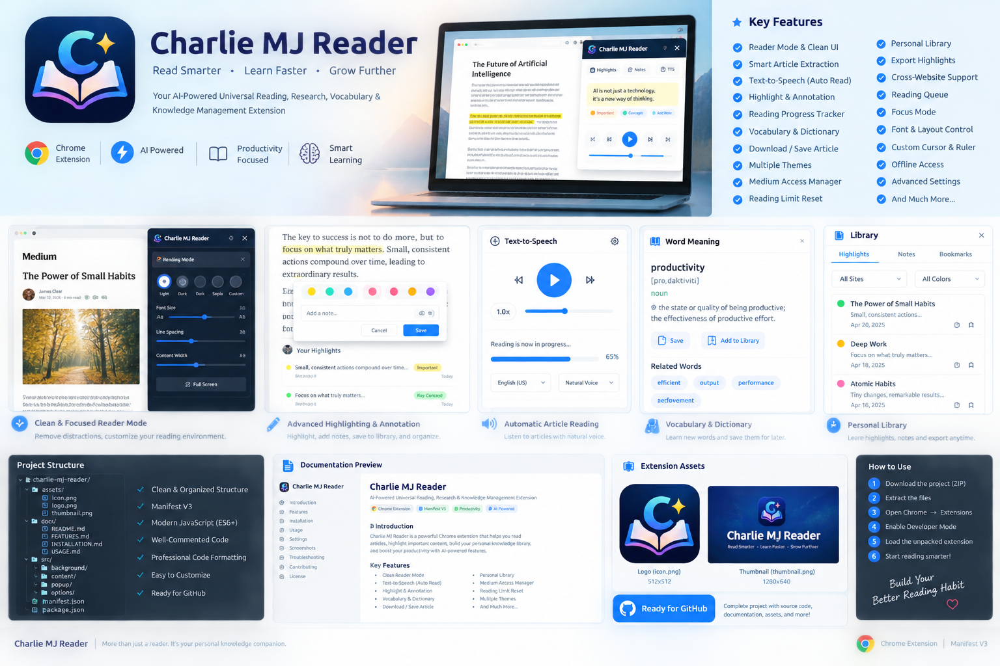

# Charlie MJ Reader

**Read Smarter. Learn Deeper. Build Your Knowledge.**


A local-first Chrome Manifest V3 extension for distraction-free reading, article capture, highlights, notes, vocabulary, synchronized text-to-speech, a website/newspaper library with SEO data, productivity tools and portable backups. Plain JavaScript, no build step.

**It works only on the websites you choose.** Everywhere else it sleeps: nothing is injected, observed, tracked or changed.

<p align="center">
  <a href="/downloads/Charlie-MJ-Reader v1.0.0.zip">
    
  </a>
</p>

<p align="center">
    
</p>

> Everything under *Features* exists in the extension. Items under [Not included / limitations](#not-included--limitations) are not claimed as complete.

## Contents

- [Quick start](#quick-start)
- [Supported Websites and Sleep Mode](#supported-websites-and-sleep-mode)
- [Features](#features)
- [Right-click menu on links](#right-click-menu-on-links)
- [Medium / Freedium](#medium--freedium)
- [Settings reference](#settings-reference)
- [Data, backup & sync](#data-backup--sync)
- [Permissions and privacy](#permissions-and-privacy)
- [Project layout](#project-layout)
- [Not included / limitations](#not-included--limitations)
- [Developer standards](#developer-standards)
- [Assets & thumbnails](#assets--thumbnails)
- [Documentation](#documentation)
- [License](#license)

## Quick start

1. Download and extract the ZIP.
2. Open `chrome://extensions`.
3. Enable **Developer mode**.
4. Choose **Load unpacked** and select this project folder.
5. Pin Charlie MJ Reader to the Chrome toolbar.
6. Open **Settings → Supported Websites** and add the sites you read (Medium and a starter list are included).
7. Open an article on a supported site and use the floating toolbar or the popup.

After reloading or updating the extension, supported tabs that are already open wake up automatically; other tabs need no action.

## Supported Websites and Sleep Mode

**Settings → Supported Websites** is the single master switch.

| Page | Behaviour |
|---|---|
| Supported and enabled | 🟢 **Active** — toolbar, highlighter, reading tools and article capture are available |
| Supported but disabled, or excluded by a path rule | 😴 **Sleeping** |
| Any other website (Gmail, YouTube, search engines, …) | 😴 **Sleeping** — completely untouched |

While sleeping there is **no toolbar, no selection toolbar / highlighter, no focus mode or ad hiding, no reading or scroll tracking, no native reading, no text-to-speech, no article detection, no injected CSS, no page changes and nothing stored**. The toolbar icon shows a grey **zzz** badge, and the popup states *Sleeping* or *Active* for the current tab. The Reader workspace, saved library, vocabulary and settings are extension pages and work regardless.

Changes apply immediately: adding or enabling a site wakes its open tabs, and removing or disabling it puts them back to sleep and removes all of the extension's listeners, timers, styles and elements from the page. A library website never activates the extension by itself; only the Supported Websites list does.

### Per-website controls

Each website card has **Restrictions & per-site features**:

- **Enabled / Disabled** and **Include subdomains**
- **Only these paths** and **Never on these paths** (e.g. `/articles/*`, `/account`)
- Floating toolbar · Selection toolbar / highlighter · Vocabulary & translation · Listen / text-to-speech · Focus mode & ad hiding · Pomodoro / 80-20 · Native reading · Reading tracking · Auto-scroll · Article detection

Also available: **Test a page** (paste an address to see *Active* or *Sleeping*, including path rules), filter the list, import / export JSON, and validate.

## Features

### Floating page toolbars
Shown on active websites only.

| Toolbar | What it does |
|---|---|
| **Main toolbar** | Reader Workspace, Vocabulary, Productivity Reader, Focus, Productivity, night toggle, hide (×). Pressing an open tool again closes its panel; the toolbar stays while you click the page. |
| **Vocabulary / selection toolbar** | Appears beside selected text: **See Translate**, **Meaning**, **＋ Vocabulary**, **Quote**, **Paragraph**, **Selection**, **Copy**, **Notes**, **Pronunciation**. Optional auto-translate and auto-save. |
| **Media toolbar** | Listen in Productivity Reader, Play / Pause / Stop, progress, speed, bookmark reading position. |
| **Productivity toolbar** | Focus, Day/Night, Pomodoro, 80/20 timer and native-reading controls. |

- Six toolbar types: floating, navbar, sidebar, right-sidebar, bottom-navbar, bubble — global default plus per-website override.
- Position, opacity and independent colour themes (main, media, vocabulary, productivity).
- Buttons give immediate feedback: busy state while working, duplicate clicks ignored, short confirmations (copied, saved, focus on/off), and a clear message if the extension was reloaded.

### Reader Workspace (full-page app)
Sections: **Dashboard, My Library, See Saved, Bookmarks, History, Highlights, Notes, Quotes, Vocabulary, Collections, Analytics, Exports, Productivity Reader**. The separate **Language Learning** workspace is available from the supported-site toolbar and Reader sidebar.

- **Read Yourself** opens a saved article; **Listen** opens it and starts speech.
- Semantic article HTML is kept separately from the UI (headings, paragraphs, lists, quotes, tables, code, links, images, captions) and sanitized with an allow-list.
- Featured image, author, date, description and automatic **table of contents**.
- Font size, width and line height; themes *default-dark, midnight, charcoal, slate, pure-white, soft-white, sepia, warm-paper*.
- Mouse-follow line/word focus and reading-position restore.
- Right-side capture tools for Vocabulary, Quotes, Paragraphs and custom Selections.
- Reading history, progress, completion tracking and analytics.

### Smart Audio Reader
- Play / resume, pause, stop, previous / next sentence, progress %, word counter.
- Word, sentence or combined highlighting; auto-scroll; voice, speed and pitch.
- Sleep timer, bookmark at position, **Add note at position**, repeat word, focus mode, keyboard shortcuts, optional next-article playback.
- Starts only on your action. Word-level precision depends on your system voices (sentence-level fallback included).

### Capture & saved content
- Save the page or a selection from the popup, toolbar or the right-click menu.
- Highlights, notes, quotes, paragraphs/lines, custom selections and reading-position bookmarks.
- **See Saved**: per-article cards and detail view (paragraphs & lines, words, quotes, highlights, notes, bookmarks, selections). Saved-library search with suggestions.

### Language Learning Mode

A separate workspace is available from the supported-site toolbar and Reader Workspace. It reuses the existing saved-article and vocabulary records rather than creating a duplicate Reader database.

- Capture a supported active page and open it in the Language Learning Reader.
- Read saved articles with a safe semantic HTML allow-list and optional grammar-category highlighting.
- Select words, phrases or sentences to save shared vocabulary, sentences, expressions or grammar notes.
- Translate selected text through the extension's existing translation service and use browser speech synthesis for pronunciation/listening.
- Set a learner CEFR preference from A1 to C2 and view estimated article difficulty.
- Export language-learning records as JSON.

Grammar highlighting in v1.0.0 uses a lightweight English heuristic. It is deliberately presented as a reading aid, not a certified grammar parser or CEFR assessment. Language-specific morphology and advanced AI analysis are not included in this release.

### Vocabulary
- Entries with translation, definition, examples, part of speech, pronunciation, synonyms, notes, tags and source.
- Nested categories, copy, edit, delete, mark mastered, revision quiz, export Markdown / CSV / JSON.
- Translation through the public MyMemory endpoint (default Turkish → English, configurable); only the selected text is sent, and only when you press Translate.

### My Reading Library
Tabs: **Websites · Newspapers / News · Profile Pages · Favorite · Category · Tags · Saved Articles · Recent · All Saved · General Settings · Compatibility Adapters**.

- Add the current website or add by address; refresh, import, export; bundled starter list.
- Newspapers worldwide (country filter) and profile pages (Medium, DEV, Substack, Hashnode, GitHub, generic `/@name`, `/author/`).
- Automatic categories (Tech, Health, Science, Business, Lifestyle, Education, Sports, Entertainment, News); manual edits lock a category.
- Logos, **Details** view (overview, latest articles, SEO & ranking, saved articles, raw JSON).
- SEO tools: 14-check on-page score, Tranco rank with trend, Google PageSpeed/Lighthouse, per-article audits, robots.txt / sitemap detection, Google `site:` shortcuts.

### Article Library
Same records as Saved Articles: search, refresh, import / export / download, details, edit, remove, **Refresh & Fetch**, **See Saved**.

### Focus & productivity
- Focus mode (brightness, contrast, opacity, dimming, blur, warmth, font scale, hide large images), Day / Night / Auto.
- Best-effort ad hiding (not a full ad blocker).
- Native reading: word-by-word highlighting on the page with configurable timer, delay, colours and optional auto-scroll.
- Pomodoro and 80/20 timers.

### Notifications & exports
- Toast notifications (any corner, duration, per-event toggles) and button-click feedback.
- Article export as Markdown, TXT, HTML, JSON; highlights, captures and vocabulary exports; full JSON backup / restore; database ZIP.

## Right-click menu on links

Right-click any link → **Charlie MJ Reader** →
1. **Open article in Reader Workspace**
2. **Save article to Saved Articles**

The page is read in a hidden background tab (Medium links through Freedium) and stored once; an incomplete earlier copy is refreshed when the new capture is longer. This menu is an explicit action you trigger, so it also works for links to sites that are not in Supported Websites. Right-click **Save page / Save selection** items on a sleeping website show a short "sleeping" notice instead.

## Medium / Freedium

- Detects Medium articles and can open them through a configurable **Freedium** mirror (HTTPS service URL, new-tab option). The mirror inherits Medium's status in Supported Websites.
- Extraction finds the container that holds the article text (any story layout), accepts any length and rejects only verification or error pages.
- Re-opening or re-saving replaces an incomplete saved copy when the new capture is longer.
- **Adapter packages**: import a ZIP (`adapter.json` + entry + README) in *Medium Compatibility → Adapter Package Manager*. Paths, version, entry, compression, file count and size are validated; executable types are blocked; imported JavaScript is stored as data and never executed. See `docs/ADAPTER-PACKAGES.md`.
- The extension does not bypass authentication, paywalls or quotas.

## Settings reference

Panels: **My Reading Library · Smart Audio Reader · General · Appearance & Themes · Toolbars · Supported Websites · Reading Preferences · Highlight Preferences · Text-to-Speech · Vocabulary · AI Configuration · Notifications · Storage & Backup · Privacy & Permissions · Medium Compatibility · Knowledge Intelligence · Topics & Knowledge · Productivity Centre · Performance & Diagnostics · Database Manager · GitHub Data Sync · Focus**.

## Data, backup & sync

- Everything is stored locally in `chrome.storage.local` (`unlimitedStorage`).
- Backup / restore JSON with validation; import from Library/History.
- Database Manager: portable `database/My Reading Library/` tree and a full database ZIP.
- GitHub Data Sync (preparation): compares My Reading Library and builds a difference ZIP of new/modified files, plus a manual JSON writer to a folder you pick. There is no automatic GitHub push or pull.

## Permissions and privacy

| Permission | Why |
|---|---|
| `storage`, `unlimitedStorage` | Local library and settings |
| `activeTab`, `scripting`, `tabs` | User-initiated capture, adding page styles on supported sites, opening the reader |
| `contextMenus` | Save selection / page and the link menu |
| `notifications` | Short confirmations |
| Host access `http://*/*`, `https://*/*` | Lets the page script exist; it acts only on Supported Websites. Also used to fetch library data and Freedium pages |
| `api.dictionaryapi.dev`, `api.mymemory.translated.net`, `freedium-mirror.cfd` | Dictionary, translation, Medium mirror |

- On unsupported websites the page script performs a single local settings check and stops.
- Requests coming from a web page are accepted by the background worker only for Supported Websites.
- AI settings are opt-in; the extension does not send article text to any AI service.
- Fetched third-party HTML is stripped of inline event handlers and `javascript:` URLs; the strict MV3 content security policy is kept.
- No cookie manipulation, paywall bypass or quota reset.

## Project layout

```text
Charlie-MJ-Reader/
├── assets/                 # Logo, icons, thumbnails (incl. Instagram Story 9:16)
├── database/               # Website seed list and index (My Reading Library)
├── docs/                   # User, feature, privacy, adapter, developer documentation
├── extensions/adapters/    # Adapter package notes
├── src/
│   ├── background/         # Service worker, Freedium fetch, sleep badge, link context menu
│   ├── content/            # Page toolbars (starts only on Supported Websites)
│   ├── lib/                # Site gate, storage, extraction, reading engine, sites/SEO, export
│   ├── library/            # My Reading Library workspace
│   ├── options/            # Settings center
│   ├── popup/              # Extension popup
│   └── reader/             # Reader workspace, Productivity Reader, See Saved
├── tests/                  # Manual QA checklist
├── manifest.json
└── README.md
```

## Not included / limitations

- No AI summaries, Q&A or flashcards (configuration storage only).
- No true PDF/DOCX generation, semantic search, knowledge graph, cloud sync or automatic GitHub sync.
- No adaptive spaced-repetition engine (basic review scheduling).
- No official Medium account or quota status.
- Ad hiding is best-effort; extraction quality varies by site; audio word-sync depends on system voices.
- Scripted browser tests cover the activation gate, sleep/wake and toolbar behaviour; run the manual checklist in `tests/QA-CHECKLIST.md` in Chrome before releasing.

## Developer standards

- Small feature-focused files; JSDoc on core modules.
- 2-space indentation, semicolons, descriptive names.
- No inline event handlers; UI content escaped before HTML rendering.
- Anything that touches a web page must pass the Supported Websites gate (`src/lib/site-gate.js`) first.

## Assets & thumbnails

| File | Size | Use |
|---|---|---|
| `assets/thumbnail.png` | 1536×1024 | Repository / store overview |
| `assets/thumbnail-instagram-story.png` | **1080×1920 (9:16)** | Instagram Story / Reels cover; key content sits inside the safe area (≈250 px top, ≈340 px bottom) |
| `assets/logo.svg`, `assets/icons/` | 16–128 px | Extension icons |

## Documentation

See [`docs/`](docs/README.md): installation, user guide, feature matrix, privacy, architecture, Smart Audio Reader, adapter packages and QA.

## License

MIT — see `LICENSE`.


For the expanded Language Learning Library, website classification, CEFR preferences, grammar appearance controls, and learning exports, see [`docs/LANGUAGE-LEARNING.md`](docs/LANGUAGE-LEARNING.md).
